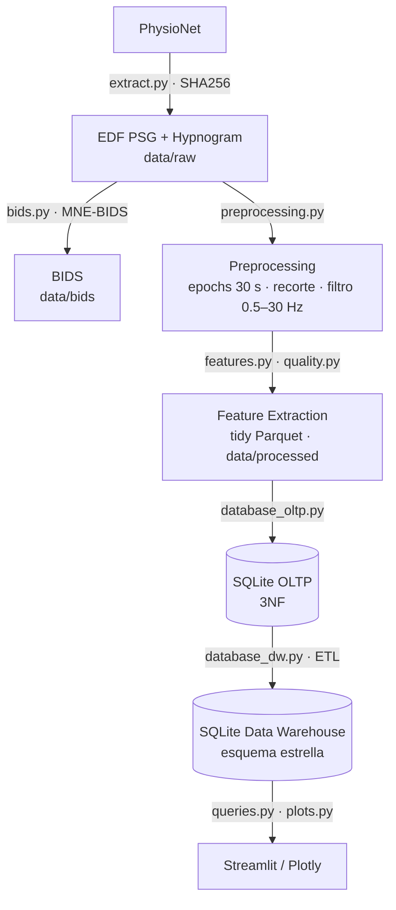

# Complejidad y actividad espectral del EEG en las etapas del sueño

Pipeline reproducible de Ingeniería de Datos sobre EEG de sueño público (Sleep-EDF Expanded, PhysioNet):
descarga automática, organización BIDS, ETL en epochs de 30 s, métricas espectrales y de complejidad, control de
calidad, base SQLite transaccional (3NF), Data Warehouse en esquema estrella, consultas SQL, visualizaciones Plotly
y dashboard Streamlit.

*Trabajo Práctico Final — Introducción a la Ingeniería de Datos.*

## Preguntas de investigación

> 1. ¿Cómo varían la complejidad y la actividad espectral del EEG entre las distintas etapas del sueño?
> 2. ¿Cómo cambia ese perfil con la edad?

El foco del trabajo es el **pipeline de datos**; la pregunta neurocientífica es el caso de estudio. Los resultados son
descriptivos (sin inferencia estadística).

## Dataset

[Sleep-EDF Expanded](https://physionet.org/content/sleep-edfx/1.0.0/) (Kemp et al., 2000; DOI
[10.13026/C2X676](https://doi.org/10.13026/C2X676)), subconjunto *sleep-cassette*: polisomnografías de personas
sanas con hipnogramas puntuados por expertos. Se usan los canales EEG **Fpz-Cz** y **Pz-Oz** (100 Hz).

Por defecto se procesan **18 sujetos × 2 noches**, estratificados por sexo y edad: 3 mujeres y 3 hombres en cada
grupo etario (<40, 40-64 y 65+), de 26 a 101 años (`SUBJECT_IDS` en `src/config.py`). Los primeros 10 IDs del dataset
son todas mujeres de 25–34 años, por eso no se usan. Con `SUBJECT_IDS = None` se toman los primeros `N_SUBJECTS`
sujetos. Los archivos se descargan programáticamente y se verifican contra los SHA256 oficiales.

## Arquitectura



## Estructura del repositorio

```
├── data/
│   ├── raw/          EDF originales + manifest de descarga (no versionado)
│   ├── bids/         dataset organizado según BIDS (no versionado)
│   ├── processed/    tablas Parquet, reportes y caché por registro (no versionado)
│   └── database/     sleep_oltp.sqlite y sleep_dw.sqlite (no versionado)
├── notebooks/
│   └── TP_final.ipynb   documento principal del TP
├── src/
│   ├── config.py         rutas, selección de sujetos, parámetros y umbrales
│   ├── extract.py        descarga validada desde PhysioNet
│   ├── bids.py           conversión a BIDS
│   ├── preprocessing.py  lectura EDF, validación, epochs, filtrado
│   ├── features.py       potencias de banda, entropías, RMS, pico a pico
│   ├── quality.py        artefactos, outliers, datos faltantes
│   ├── outliers.py       diagnóstico de outliers (reglas y detectores multivariados)
│   ├── pipeline.py       orquestación del Transform con caché
│   ├── database_oltp.py  base transaccional 3NF
│   ├── database_dw.py    ETL al Data Warehouse
│   ├── queries.py        consultas analíticas SQL
│   ├── plots.py          figuras Plotly
│   ├── validation.py     validaciones automáticas
│   └── app.py            dashboard Streamlit
├── requirements.txt
└── README.md
```

Los datos no se versionan: todo `data/` se reconstruye desde la fuente pública al ejecutar el notebook.

## Instalación

Requiere Python ≥ 3.10.

```bash
git clone <URL-del-repositorio>
cd <repositorio>
python -m venv .venv
# Windows: .venv\Scripts\activate    ·    Linux/macOS: source .venv/bin/activate
pip install -r requirements.txt
```

| Dependencia | Uso |
|---|---|
| numpy, pandas, scipy | Cálculo numérico, tablas, PSD de Welch |
| mne, mne-bids | Lectura EDF, filtrado, organización BIDS |
| antropy | Sample Entropy y Spectral Entropy |
| pyarrow | Parquet |
| xlrd | Lectura de `SC-subjects.xls` (metadatos oficiales de sujetos) |
| plotly, streamlit | Visualización y dashboard |

SQLite se usa mediante el módulo `sqlite3` de la biblioteca estándar.

## Ejecución local

Abrir `notebooks/TP_final.ipynb` (VS Code o Jupyter) y ejecutar todas las celdas. El notebook descarga los datos,
genera BIDS, procesa los registros, construye ambas bases, ejecuta las consultas y muestra el EDA.

- Primera ejecución con 18 sujetos × 2 noches: ~40–45 min y ~3,5 GB de disco, casi todo en el cálculo de Sample Entropy. Las
  ejecuciones siguientes reutilizan las descargas y el caché por registro y tardan segundos.
- `QUICK_RUN = True` en la celda de configuración procesa 2 sujetos para una prueba rápida.

## Ejecución en Google Colab

1. Subir el repositorio a GitHub y completar `REPO_URL` en la primera celda de código del notebook.
2. Abrir el notebook en Colab (*File → Open notebook → GitHub*).
3. *Runtime → Run all*. La primera celda detecta Colab, clona el repositorio e instala `requirements.txt`.

## Generación de las bases

Las bases se generan desde el notebook (secciones *SQLite OLTP* y *Data Warehouse*). También pueden generarse sin el
notebook, desde la raíz del repositorio:

```python
from src import extract, bids, pipeline, database_oltp, database_dw

manifest = extract.run_extract()
bids.run_bids(manifest)
out = pipeline.run_pipeline(manifest)
database_oltp.build_oltp(out["tidy"], out["recordings"])
database_dw.build_dw()
```

Ambas bases se reconstruyen desde cero en cada ejecución.

## Dashboard Streamlit

```bash
streamlit run src/app.py
```

Lee únicamente `data/database/sleep_dw.sqlite`. Tiene filtros por sujeto, registro, canal, etapas e
inclusión de artefactos, y muestra:

- hipnograma;
- Sample Entropy y Spectral Entropy por etapa;
- potencia relativa por banda;
- heatmap etapa × banda;
- scatter delta vs Sample Entropy.

**En Colab**, Streamlit necesita un túnel, por ejemplo:

```python
!streamlit run src/app.py --server.port 8501 &>/content/streamlit.log &
!npx --yes localtunnel --port 8501
```

Las mismas figuras se muestran directamente en la sección EDA del notebook.

## Modelo OLTP (`sleep_oltp.sqlite`)

```
subject 1─N recording 1─N epoch N─1 hypnogram_label N─1 sleep_stage
                            │
                            1─N eeg_feature N─1 channel
```

- **Restricciones**: PK, FK (`PRAGMA foreign_keys = ON`), UNIQUE, NOT NULL y CHECK de dominio. Hay índices sobre
  las FK.
- **3NF**:
  - la etiqueta original del hipnograma está en `hypnogram_label`, lo que evita la dependencia transitiva
    epoch → etiqueta → etapa;
  - los atributos derivados no se almacenan y se calculan en vistas: `start_sec` en `v_epoch`, y la potencia total y
    las relativas en `v_eeg_feature`;
  - el flag de artefacto depende del canal, por eso vive en `eeg_feature`.

## Data Warehouse (`sleep_dw.sqlite`)

Esquema estrella con `fact_eeg_epoch` y 3 dimensiones con surrogate keys: `dim_recording`, `dim_channel` y
`dim_sleep_stage`. Sujeto y grupo etario son una jerarquía dentro de `dim_recording`, porque cada registro pertenece a
un único sujeto. Las dimensiones forman el cubo etapa × grupo etario × canal (5 × 3 × 2 = 30 celdas).

**Grano**: una observación de features EEG correspondiente a un epoch de 30 segundos, un canal, un sujeto y un
registro.

El ETL extrae desde el OLTP y materializa métricas derivadas, tiempo desde el inicio del sueño y flags de outlier.
Las 13 consultas analíticas están en `src/queries.py`, incluidas las operaciones del cubo: slice, dice, roll-up y
drill-down.

## Reproducibilidad

- Datos públicos descargados por código y verificados contra los SHA256 oficiales.
- Rutas relativas con `pathlib`.
- Parámetros centralizados en `src/config.py`.
- Caché por registro, invalidado por un hash de los parámetros y de la versión del código.
- Semilla fija (`RANDOM_SEED`).
- Bases reconstruidas en cada ejecución, con claves determinísticas.
- Validaciones automáticas en cada etapa.
- Versiones de las librerías registradas en `data/processed/environment.json`.

## Trabajo futuro: almacenamiento de EEG continuo

Este proyecto almacena features por epoch, un volumen que SQLite maneja sin problema. Para adquisición continua de
EEG (por ejemplo, *wearables* de sueño que transmiten muestras en tiempo real), una base de series temporales como
**TimescaleDB** (PostgreSQL) sería más apropiada: particionado por tiempo, compresión, agregados continuos y
políticas de retención. No es necesaria para este TP.

## Declaración de uso de IA

- "Claude Code (Claude Opus 5.5)" para "diseñar la arquitectura del pipeline ETL y los modelos OLTP y dimensional".
- "Claude Code (Claude Opus 5.5)" para "generar y revisar el código Python y SQL".
- "Claude Code (Claude Opus 5.5)" para "redactar y revisar las justificaciones metodológicas y la documentación".
- "Claude Code (Claude Opus 5.5)" para "diseñar el dashboard, los gráficos y las diapositivas".

Las instrucciones dadas a la IA están en `notebooks/TP_final.ipynb`, antes de cada sección.

## Licencia y citas

El código de este repositorio se distribuye con fines académicos. Los datos de Sleep-EDF Expanded se publican bajo
la *Open Data Commons Attribution License v1.0*. Si se usan, citar:

- Kemp B, Zwinderman AH, Tuk B, Kamphuisen HAC, Oberyé JJL. *Analysis of a sleep-dependent neuronal feedback loop:
  the slow-wave microcontinuity of the EEG.* IEEE Trans Biomed Eng. 2000;47(9):1185–1194.
- Goldberger A, et al. *PhysioBank, PhysioToolkit, and PhysioNet.* Circulation. 2000;101(23):e215–e220.
